# Lista Master Class — Diagrama de Classes UML e Organização da Arquitetura de Software

---

# Parte 1 — Fundamentos da modelagem estrutural

## Exercício 1 — Modelagem comportamental × estrutural

**a)** O Diagrama de Casos de Uso mostra **quem** usa o sistema e **quais funcionalidades** ele oferece (escopo e fronteira).

**b)** O Diagrama de Sequência mostra **como os participantes colaboram ao longo do tempo** para realizar um cenário de um caso de uso (mensagens e ordem).

**c)** O Diagrama de Classes mostra a **estrutura estática** do sistema: classes, atributos, operações, relacionamentos e multiplicidades.

**d)** O Diagrama de Sequência não apresenta necessariamente: atributos das classes, tipos e visibilidade, multiplicidades, relacionamentos permanentes (associação, composição, herança) nem classes que não participam daquele cenário.

**e)** Os três se complementam: o de Casos de Uso define *o que* o sistema faz; o de Sequência mostra *como* um cenário é realizado e revela as operações e responsabilidades; o de Classes consolida essas informações na estrutura que será implementada. As mensagens da sequência viram operações das classes, e os participantes viram classes.

---

## Exercício 2 — Identificação de classes

**Classes, atributos, operações e responsabilidade**

| Classe | Atributos | Operações | Responsabilidade |
|---|---|---|---|
| Livro | id, título, autor, ISBN | adicionarExemplar(), listarExemplaresDisponiveis() | Representar a obra e seus exemplares |
| Exemplar | id, código, situação | estaDisponivel(), marcarEmprestado(), marcarDisponivel() | Representar a cópia física emprestável |
| Aluno | id, nome, matrícula | listarEmprestimos() | Representar o usuário que toma livros emprestados |
| Emprestimo | id, dataEmprestimo, dataPrevistaDevolucao, dataDevolucao | registrarDevolucao(), estaAtrasado() | Registrar o empréstimo de um exemplar a um aluno |

**Relacionamentos**
- Livro 1 — 1..* Exemplar (um livro possui vários exemplares).
- Aluno 1 — 0..* Emprestimo (cada empréstimo pertence a um único aluno).
- Emprestimo 0..* — 1 Exemplar (cada empréstimo está associado a um exemplar).

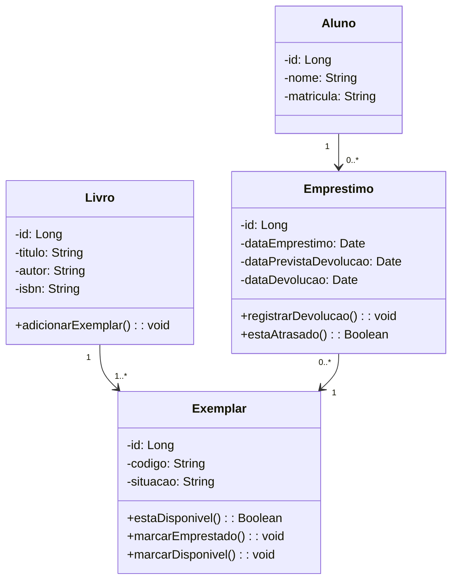

**Discussão:** Não. Nem todo substantivo vira classe. Alguns são **atributos** (data do empréstimo, data de devolução), outros são sinônimos ou termos fora do escopo do sistema (ex.: "biblioteca" pode ser o próprio sistema). Vira classe o conceito que tem **identidade, atributos próprios e comportamento** relevantes para o domínio.

---

## Exercício 3 — Anatomia de uma classe UML

**a)** Nome da classe (superior), **atributos** (central) e **operações** (inferior).

**b)** Atributos são os **dados** (estado) que o objeto guarda; operações são os **comportamentos** (o que o objeto sabe fazer).

**c)** `+` é visibilidade **pública** (acessível por outras classes); `-` é **privada** (acessível só dentro da própria classe).

**d)** É o **tipo** do atributo, ou o **tipo de retorno** da operação.

**e)** Porque as operações expressam as **responsabilidades** da classe e o comportamento esperado, que é o que as outras classes usam. Só com atributos temos apenas dados, sem saber o que a classe faz.

**f)** A visibilidade implementa o **encapsulamento**: atributos privados ocultam o estado interno, e o acesso ocorre apenas por operações públicas, que podem validar regras e proteger a consistência do objeto.

---

# Parte 2 — Relacionamentos entre classes

## Exercício 4 — Associação e multiplicidade

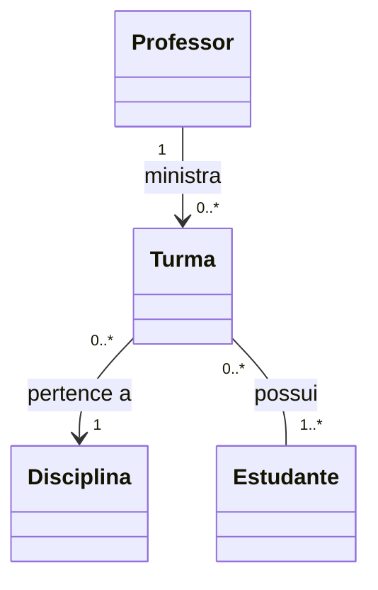

*(Estudante participa de várias turmas: `0..*` no lado de Turma; Turma tem vários estudantes: `1..*` no lado de Estudante.)*

**Multiplicidades**
- `1` — exatamente um.
- `0..1` — zero ou um (opcional).
- `0..*` — zero ou mais.
- `1..*` — um ou mais (ao menos um).

**Importância:** definem **quantos objetos** podem se relacionar, o que influencia a implementação: atributo simples ou coleção, obrigatoriedade (`not null`), chaves estrangeiras e tabelas associativas (relação N:N), e validações.

---

## Exercício 5 — Associação, agregação e composição

**a)**
- Cenário A: **agregação** (Departamento existe independentemente da Universidade).
- Cenário B: **composição** (Item não tem sentido sem o Pedido).
- Cenário C: **associação** (professor e disciplina se relacionam, sem propriedade nem dependência de ciclo de vida).

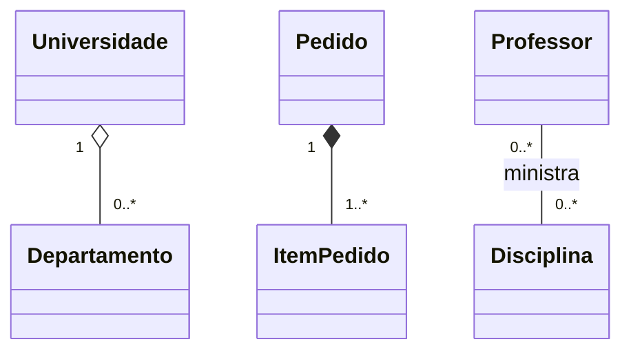

**b)**
- **Associação:** relação genérica entre objetos independentes.
- **Agregação:** relação "todo-parte" **fraca**: a parte existe sem o todo e pode ser compartilhada.
- **Composição:** relação "todo-parte" **forte**: a parte pertence exclusivamente ao todo e seu ciclo de vida depende dele.

**c)** Quando o objeto composto deixa de existir, as **partes são destruídas junto** (ex.: ao remover o Pedido, seus itens deixam de existir).

**d)** Porque composição expressa **propriedade exclusiva e dependência de ciclo de vida**, não mera referência. Referenciar outra classe geralmente é apenas associação; usar composição indevidamente cria dependências e regras de exclusão que não existem no domínio.

**Justificativa:** *identidade* (Departamento e Disciplina têm identidade própria; Item não), *propriedade* (o Pedido é dono exclusivo dos itens) e *ciclo de vida* (itens morrem com o pedido; departamento sobrevive à universidade).

---

## Exercício 6 — Herança e generalização

**a)** Superclasse `Pagamento`: `id`, `valor`, `data`, `situacao`.

**b)** Compartilhados: `confirmar()`, `cancelar()`, `estaPago()`, consulta da situação.

**c)** Específicos:
- `PagamentoPix`: chave, identificador da transação.
- `PagamentoCartao`: número mascarado, bandeira, parcelas, `autorizar()`.
- `PagamentoBoleto`: código de barras, vencimento, `gerarBoleto()`.

**d)**

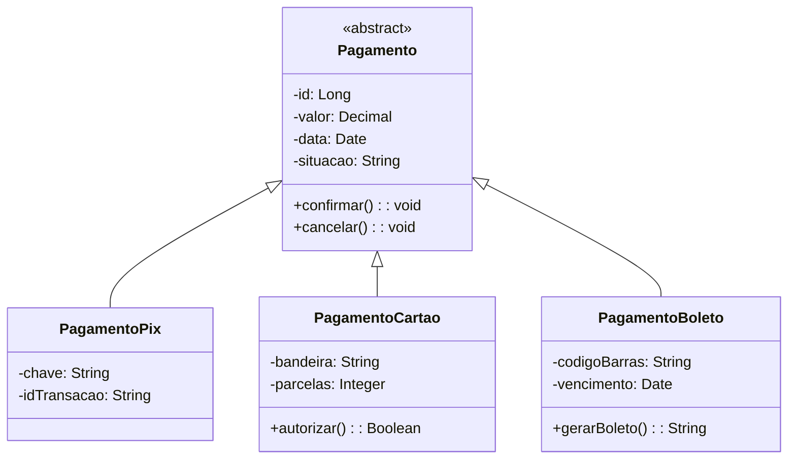

**e)** **Herança** expressa "é um" (Pix é um Pagamento) e reaproveita estrutura e comportamento da superclasse. **Composição** expressa "tem um" (Pedido tem Itens) e monta o objeto a partir de partes.

**f)** A herança prejudica quando cria hierarquias profundas, acopla subclasses à superclasse (mudanças a afetam todas), é usada só para reaproveitar código sem relação "é um", ou quando surgem combinações de variações (ex.: novos tipos que não se encaixam). Nesses casos, prefere-se composição.

---

# Parte 3 — Responsabilidades e qualidade do projeto

## Exercício 7 — Classes anêmicas e responsabilidades

**a)** `Pedido` só guarda dados (id, valor total, status); não tem comportamento (é anêmica).

**b)** `PedidoService` concentra todas as regras: calcular total, cancelar e aplicar desconto.

**c)** Comportamentos próprios do domínio `Pedido`: `calcularTotal()`, `cancelar()` (que valida se pode cancelar e muda o status), `adicionarItem()`, `confirmar()`. O pedido conhece seus itens e seu estado.

**d)** Concentrar tudo em uma `Service` gera classes inchadas, entidades sem comportamento, regras espalhadas e difíceis de reutilizar, e dificulta testar e evoluir o domínio; o objeto deixa de proteger sua própria consistência.

**e)** Distribuição proposta:
- `Pedido` (domínio): `calcularTotal()`, `cancelar()`, `confirmar()`, `adicionarItem()`.
- `PoliticaDesconto` (serviço de domínio): `calcularDesconto(pedido)`, pois envolve regras que não pertencem a uma só entidade.
- `PedidoService` (aplicação): coordena os casos de uso (`registrarPedido`, `cancelarPedido`), carrega o pedido do repositório, chama o domínio e persiste.
- `PedidoRepository`: persistência.

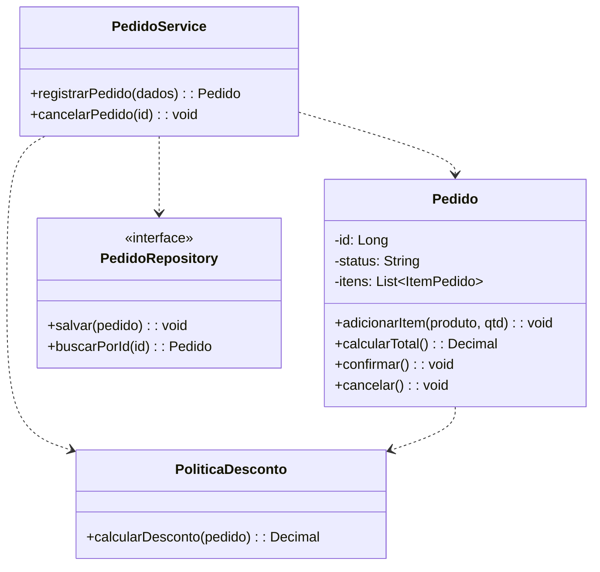

---

## Exercício 8 — Coesão e acoplamento

**a)** `SistemaManager` é uma "classe Deus": mistura responsabilidades de cadastro, preço, frete, pagamento, relatórios, autenticação e e-mail.

**b)** **Coesão** é o grau em que as responsabilidades de uma classe estão relacionadas entre si. Alta coesão: a classe faz uma coisa bem definida.

**c)** **Acoplamento** é o grau de dependência entre classes. Baixo acoplamento: mudanças em uma classe afetam pouco as demais.

**d)** Qualquer mudança afeta a mesma classe, aumenta o risco de efeitos colaterais, gera conflitos de equipe, impede reuso e obriga a testar tudo junto; é difícil isolar e testar uma regra.

**e)** Reorganização:
- `ClienteService`: `cadastrarCliente()`
- `ProdutoService`: `atualizarProduto()`
- `FreteService`: `calcularFrete()`
- `PagamentoService`: `registrarPagamento()`
- `RelatorioService`: `emitirRelatorio()`
- `AutenticacaoService`: `autenticarUsuario()`
- `EmailService`: `enviarEmail()`

**f)**

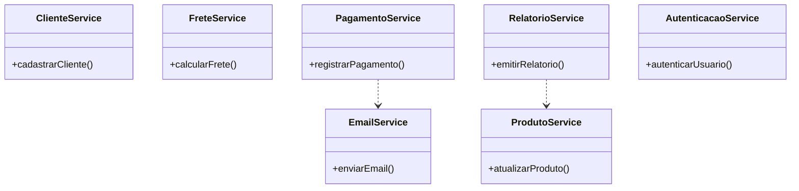

---

## Exercício 9 — Da sequência para as classes

**a)** Concretas: `TelaPedido`, `PedidoController`, `PedidoService`, `PedidoRepository` (implementação). O ator `Cliente` não vira classe do sistema.

**b)**
- Interface: `TelaPedido` (capta dados e exibe resultado).
- Aplicação: `PedidoController` / `PedidoService` (coordenam o caso de uso).
- Domínio: `Pedido`, `ItemPedido`, `Produto`, `Cliente` (regras e estado).
- Infraestrutura: `PedidoRepository` (acesso a dados).

**c)** `TelaPedido.informarDados()`, `PedidoController.registrarPedido()`, `PedidoService.registrarPedido()`, `PedidoRepository.salvar()`, `Pedido.adicionarItem()`, `Pedido.calcularTotal()`.

**d)** Só parcialmente. A sequência mostra dados trocados nas mensagens (parâmetros e retornos), que sugerem atributos (ex.: itens, cliente, total), mas não os lista nem define tipos e visibilidade; os atributos vêm da análise do domínio.

**e)**

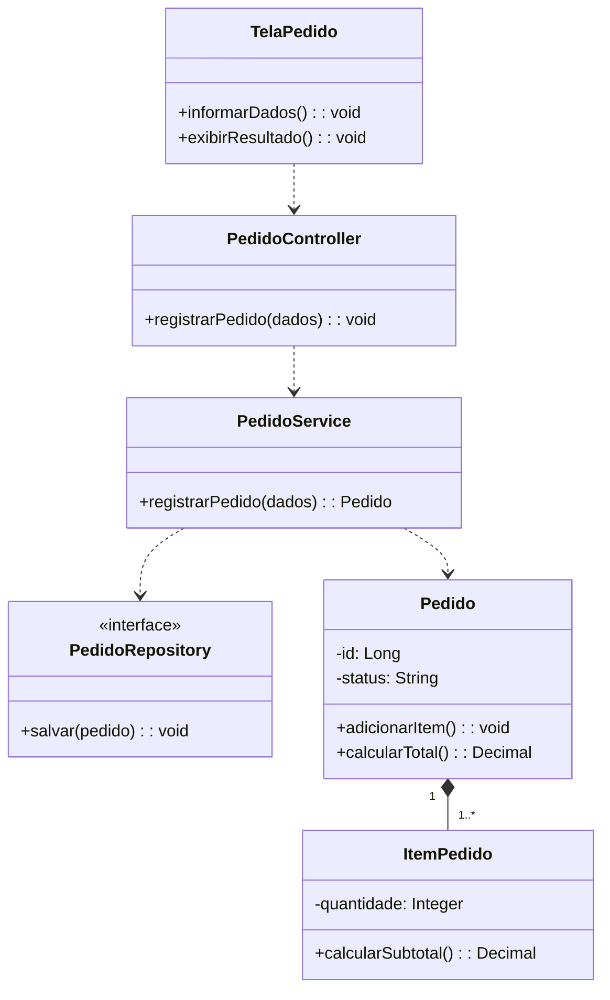

**f)** O diagrama de classes de domínio representa **conceitos do negócio**. Participantes como a tela, o controller e o repositório são de interface, aplicação e infraestrutura, e pertencem a outras visões do diagrama de classes (de projeto/arquitetura). O ator também não é classe do sistema.

---

# Parte 4 — Arquitetura de software

## Exercício 10 — Organização em camadas

| Nº | Responsabilidade | Camada |
|---|---|---|
| 1 | Receber requisições HTTP | Apresentação/Interface |
| 2 | Validar regras de negócio | Domínio |
| 3 | Coordenar a execução de um Caso de Uso | Aplicação |
| 4 | Consultar registros no banco | Infraestrutura |
| 5 | Representar uma entidade do domínio | Domínio |
| 6 | Converter dados recebidos em objetos | Apresentação (DTOs/conversão de entrada) |
| 7 | Persistir alterações | Infraestrutura |
| 8 | Retornar uma resposta HTTP | Apresentação/Interface |

**a) Finalidade e b) classes**

| Camada | Finalidade | Classes exemplo |
|---|---|---|
| Apresentação | Interagir com o usuário/cliente externo | Controllers, telas, DTOs |
| Aplicação | Coordenar os casos de uso | Services de aplicação |
| Domínio | Conter regras e conceitos do negócio | Entidades, serviços de domínio, interfaces de repositório |
| Infraestrutura | Acesso a recursos técnicos (banco, e-mail, APIs) | Implementações de repositório, clientes de e-mail |

**c)** **Camada lógica** é uma divisão por responsabilidade e regras de dependência; **diretório físico** é como os arquivos são organizados no projeto. Podem coincidir, mas são conceitos diferentes.

**d)** Não. A arquitetura exige a separação de responsabilidades, não necessariamente quatro diretórios; as camadas podem estar em pacotes por módulo ou mesmo no mesmo diretório, desde que as responsabilidades estejam separadas.

**e)** A separação isola mudanças (trocar o banco não afeta o domínio), facilita testes, localizar código, trabalho em equipe e reuso.

---

## Exercício 11 — Controller, Service, Entity e Repository

**a) Responsabilidades**
- `ProdutoController`: receber requisições HTTP, converter dados e devolver respostas.
- `ProdutoService`: coordenar os casos de uso de produto.
- `Produto`: representar o conceito e suas regras próprias (estoque, preço).
- `ProdutoRepository`: oferecer acesso aos dados de produto.

**b)** O `ProdutoController`.

**c)** O `ProdutoService`.

**d)** A entidade `Produto`.

**e)** O `ProdutoRepository`.

**f)** Porque a entidade pertence ao domínio, que deve ser independente de tecnologia de entrega (HTTP). Dependências do domínio sobre o controlador tornam o domínio difícil de testar e reutilizar e invertem o sentido correto da dependência.

**g)**

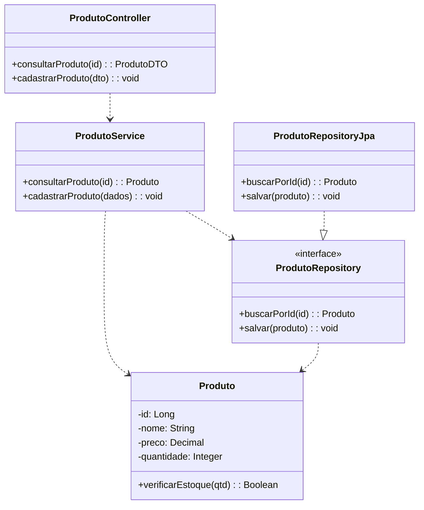

O **contrato** `ProdutoRepository` fica no domínio; a **implementação** `ProdutoRepositoryJpa` fica na infraestrutura.

---

## Exercício 12 — Dependências inadequadas

**a) Problemas:** o controlador mistura apresentação, regras de negócio (desconto, estoque, preço) e acesso a dados; regras ficam presas à camada HTTP e não podem ser reutilizadas nem testadas isoladamente; alto acoplamento ao repositório e ao banco.

**b)** Não é sempre incorreto. Em consultas simples, sem regra de negócio (listar, buscar por id), alguns projetos permitem o acesso direto. É inadequado quando há regras, como neste caso, ou quando se quer manter a camada de aplicação como única porta de entrada dos casos de uso.

**c)** Reorganização: `ProdutoController → ProdutoService → Produto + ProdutoRepository`. O controller apenas recebe/devolve; o service coordena; o domínio contém as regras; o repositório acessa os dados.

**d) Domínio:** validar estoque (`Produto.verificarEstoque()`), regras de preço e de desconto (`Produto`/`PoliticaDesconto`).

**e) Aplicação:** coordenar o caso de uso: buscar o produto, acionar as regras do domínio, persistir e devolver o resultado.

**f)**

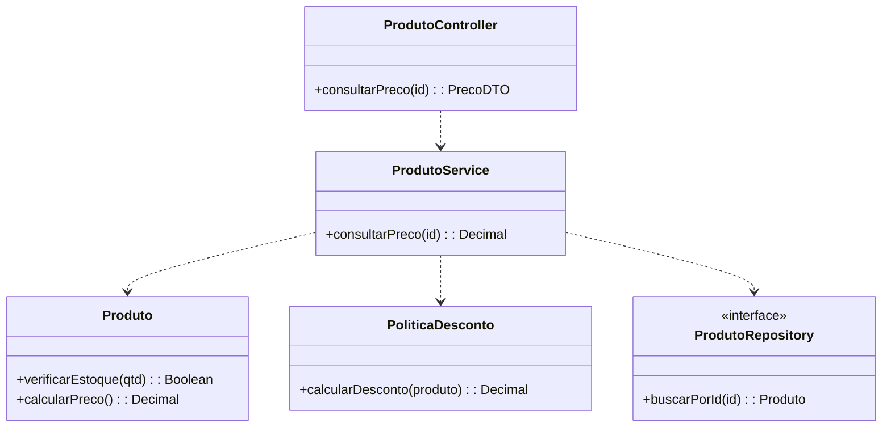

---

# Parte 5 — Organização de diretórios e documentação

## Exercício 13 — Estrutura de diretórios

**a)** Com o crescimento: pasta única com dezenas de arquivos, difícil localizar, nomes repetidos por tipo, mistura de responsabilidades, arquitetura invisível e conflitos de equipe.

**b) Por camadas**
```text
sistema/
├── controller/   ClienteController, ProdutoController, PedidoController
├── service/      ClienteService, ProdutoService, PedidoService
├── repository/   ClienteRepository, ProdutoRepository, PedidoRepository
└── model/        Cliente, Produto, Pedido
```

**c) Por funcionalidades/módulos**
```text
sistema/
├── cliente/   Cliente, ClienteController, ClienteService, ClienteRepository
├── produto/   Produto, ProdutoController, ProdutoService, ProdutoRepository
└── pedido/    Pedido, PedidoController, PedidoService, PedidoRepository
```

**d) Comparação**

| | Por camadas | Por funcionalidades |
|---|---|---|
| Critério | Tipo técnico | Assunto do negócio |
| Vantagem | Fácil ver as camadas | Tudo de uma funcionalidade fica junto; módulos independentes |
| Desvantagem | Arquivos de uma funcionalidade espalhados | Camadas menos visíveis |

**e)** A organização **por funcionalidades** (pasta `pedido/`).

**f)** Para um sistema médio, a organização **por funcionalidades**, mantendo a separação de responsabilidades dentro de cada módulo: facilita localizar e alterar uma funcionalidade, reduz o acoplamento entre módulos e escala melhor com o crescimento da equipe.

---

## Exercício 14 — Camadas × funcionalidades

**a)** A Estrutura A organiza pelo **tipo técnico** de cada classe; a B organiza pelo **assunto de negócio** (cliente, pedido).

**b)**
- A — Vantagens: arquitetura em camadas explícita, padrão conhecido, simples em projetos pequenos. Desvantagens: funcionalidades dispersas; mudar `Pedido` exige mexer em quatro pastas; pastas incham.
- B — Vantagens: alta coesão por módulo, mudança localizada, facilita fatiar ou extrair módulos. Desvantagens: camadas menos evidentes; risco de dependências cruzadas entre módulos; pode haver duplicação.

**c)** A estrutura A deixa clara a divisão técnica, mas esconde o negócio. A B deixa o negócio claro (o que o sistema faz), mas a divisão em camadas fica menos visível.

**d)** Não. Diretórios organizam arquivos; a boa arquitetura vem das **responsabilidades bem definidas e das regras de dependência** entre as classes. Pode-se ter diretórios "bonitos" com classes acopladas.

**e)** Organizar por módulos e, dentro de cada um, separar as responsabilidades (subpacotes ou convenções), por exemplo:

```text
pedido/
├── apresentacao/  PedidoController, PedidoDTO
├── aplicacao/     PedidoService
├── dominio/       Pedido, ItemPedido, PedidoRepository (interface)
└── infra/         PedidoRepositoryJpa
```

---

## Exercício 15 — Documentação da classe

| Campo | Descrição |
|---|---|
| Classe | `PedidoService` |
| Responsabilidade | Coordenar o caso de uso Registrar Pedido: receber os dados, acionar as regras do domínio, persistir o pedido e devolver o resultado. Não contém as regras de negócio em si. |
| Operações | `registrarPedido(pedido: Pedido): void` — recebe o pedido com cliente e itens; valida por meio do domínio (`Pedido`/`EstoqueService`), persiste e deixa o pedido registrado. Em caso de regra violada, lança exceção de negócio e nada é gravado. |
| Dependências | `PedidoRepository` (persistência), `Pedido` e `ItemPedido` (domínio), `EstoqueService` (verificação de estoque) |
| RN relacionadas | RN01 (pedido com cliente), RN02 (ao menos um item), RN03 (estoque suficiente) |
| RF relacionadas | RF01 — Registrar pedidos |
| UC relacionados | UC01 — Registrar Pedido |

**Discussão:** documentar um **Caso de Uso** descreve o comportamento sob a ótica do **ator** (objetivo, passos, alternativas e exceções), é uma visão do *o que* o sistema faz. Documentar uma **classe** descreve a visão do **projeto**: responsabilidade, operações, dependências e ligação com regras e requisitos, ou seja, *quem* realiza o comportamento e *como* está organizado.

---

# Parte 6 — Integração entre análise, projeto e arquitetura

## Exercício 16 — Rastreabilidade até as classes

```text
RN01  Pedido não pode ser confirmado com produto indisponível
 ↓
RF01  Registrar pedidos
 ↓
UC01  Registrar Pedido
 ↓
Diagrama de Sequência (alt: produto disponível / indisponível)
 ↓
Classes e operações:
    PedidoController.registrarPedido()
    PedidoService.registrarPedido()
    EstoqueService.verificarDisponibilidade()
    Pedido.confirmar()
    PedidoRepository.salvar()
 ↓
Módulos/diretórios: pedido/ (PedidoController, PedidoService, Pedido, PedidoRepository) e produto/ (EstoqueService, Produto)
```

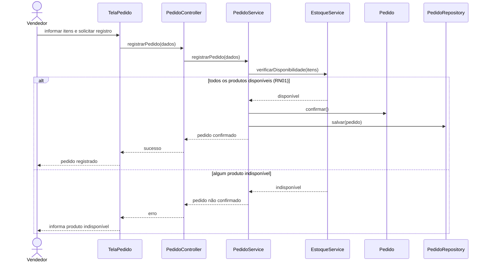

**a) Classes necessárias:** `TelaPedido`, `PedidoController`, `PedidoService`, `EstoqueService`, `Pedido`, `ItemPedido`, `Produto`, `PedidoRepository`.

**b) Quem verifica disponibilidade:** `EstoqueService` (consultando `Produto.verificarEstoque()`), chamado pelo `PedidoService`.

**c) Quem confirma o pedido:** `Pedido.confirmar()` (domínio), acionado pelo `PedidoService` somente quando todos os itens estão disponíveis.

**d) RN01 na sequência:** é a condição do fragmento `alt`: com todos os produtos disponíveis o pedido é confirmado e salvo; havendo indisponibilidade, não é confirmado.

**e) Documentação:** registrar a RN01 na documentação das classes (campo "RN relacionadas" em `PedidoService`, `EstoqueService` e `Pedido`), na matriz de rastreabilidade RN–RF–UC–classe e, em comentário/anotação, nos métodos que a aplicam.

---

## Exercício 17 — Arquitetura do sistema de estoque

**a) Classes do domínio:** `Produto`, `Movimentacao`, `TipoMovimentacao` (enum: ENTRADA/SAIDA), `Usuario`.

**b) Atributos e operações**

| Classe | Atributos | Operações |
|---|---|---|
| Produto | id, codigo, nome, quantidadeEmEstoque | `adicionar(qtd)`, `retirar(qtd)` (valida RN01), `temEstoque(qtd)` |
| Movimentacao | id, tipo, quantidade, dataHora | `registrar(...)` (criação) |
| Usuario | id, nome, perfil | `podeRegistrarMovimentacao()` |

**c) Associações:** Produto 1 — 0..* Movimentacao; Usuario 1 — 0..* Movimentacao.

**d) Diagrama de Classes do domínio**

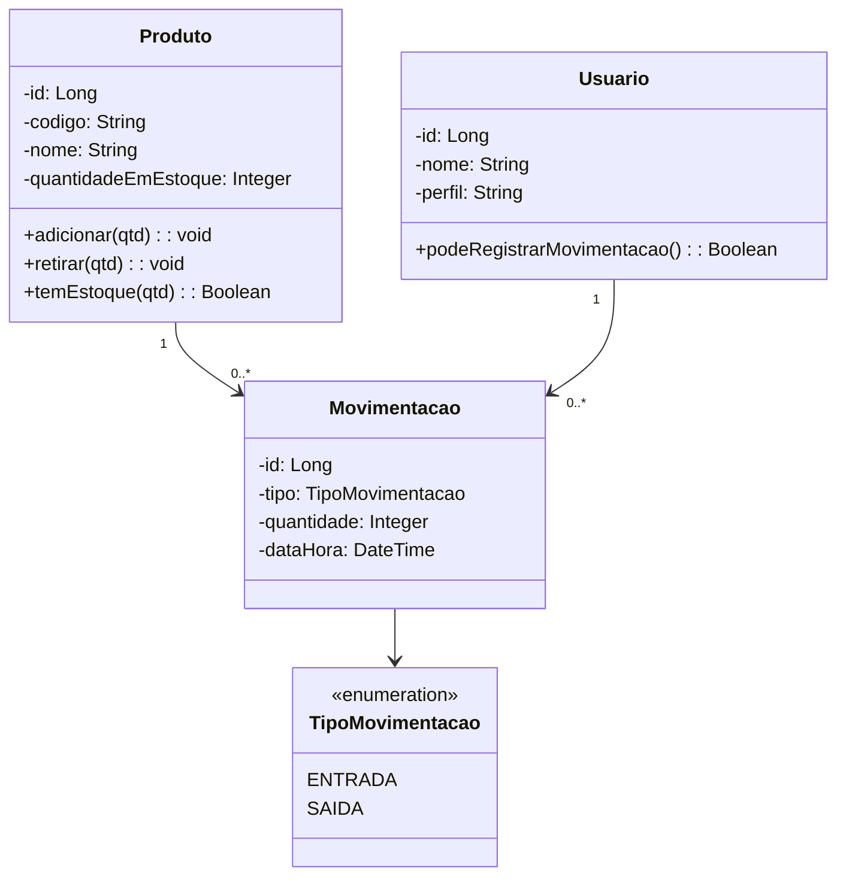

**e) Componentes de aplicação:** `ProdutoController`, `MovimentacaoController` (apresentação); `EstoqueService` (`cadastrarProduto`, `registrarEntrada`, `registrarSaida`, `consultarEstoque`); `RelatorioService` (`emitirRelatorioMovimentacoes`).

**f) Infraestrutura:** implementações de `ProdutoRepository` e `MovimentacaoRepository` (banco de dados); mecanismo de autenticação/autorização; geração do relatório (PDF/CSV).

**g) Diretórios**
```text
src/main/java/br/edu/estoque/
├── produto/        Produto, ProdutoController, ProdutoRepository
├── movimentacao/   Movimentacao, TipoMovimentacao, MovimentacaoController, MovimentacaoRepository
├── estoque/        EstoqueService, RelatorioService
├── usuario/        Usuario, AutorizacaoService
└── infra/          ProdutoRepositoryJpa, MovimentacaoRepositoryJpa
```

**h) Onde cada RN é aplicada**

| RN | Onde |
|---|---|
| RN01 — estoque não negativo | Domínio: `Produto.retirar()` rejeita saída maior que o saldo |
| RN02 — entrada gera movimentação | Aplicação: `EstoqueService.registrarEntrada()` cria `Movimentacao` junto com `Produto.adicionar()` |
| RN03 — saída gera movimentação | Aplicação: `EstoqueService.registrarSaida()` cria `Movimentacao` junto com `Produto.retirar()` |
| RN04 — só usuários autorizados | Aplicação/segurança: `EstoqueService` consulta `Usuario.podeRegistrarMovimentacao()` antes de registrar (e o controller exige autenticação) |

---

# Parte 7 — Master Class: projeto completo

## Exercício 18 — Sistema de Gerenciamento de Pedidos

### Etapa 1 — Análise

**Requisitos funcionais**
- RF01 — Cadastrar clientes.
- RF02 — Cadastrar produtos.
- RF03 — Consultar produtos.
- RF04 — Registrar pedidos.
- RF05 — Adicionar produtos ao pedido.
- RF06 — Calcular o total do pedido.
- RF07 — Confirmar pedidos.
- RF08 — Cancelar pedidos.
- RF09 — Consultar histórico de pedidos.

**Requisitos não funcionais**
- RNF01 — Desempenho: a consulta de produtos deve responder em até 2 segundos.
- RNF02 — Segurança: somente usuários autenticados acessam o sistema.
- RNF03 — Integridade/consistência: a atualização de estoque e a gravação do pedido devem ser consistentes (transação).
- RNF04 — Usabilidade/compatibilidade: funcionar nos principais navegadores.

**Atores:** Vendedor (principal), Gerente (autoriza descontos acima do limite, RN04).

**Casos de uso:** UC01 Registrar Pedido · UC02 Cadastrar Cliente · UC03 Cadastrar Produto · UC04 Consultar Produtos · UC05 Confirmar Pedido · UC06 Cancelar Pedido · UC07 Consultar Histórico de Pedidos. (Adicionar produto ao pedido e calcular total fazem parte do UC01.)

### Etapa 2 — Especificação: UC01 — Registrar Pedido

- **Objetivo:** registrar um pedido para um cliente com um ou mais produtos.
- **Ator principal:** Vendedor. **Secundário:** Gerente (autorização de desconto).
- **Pré-condições:** vendedor autenticado; cliente e produtos cadastrados.
- **Pós-condições (sucesso):** pedido registrado com itens e total calculado; estoque atualizado. **(Falha):** nenhum pedido criado.

**Fluxo principal**
1. Vendedor solicita registrar um pedido.
2. Vendedor informa o cliente (RN01).
3. Sistema cria o pedido para o cliente.
4. Vendedor informa o produto e a quantidade.
5. Sistema verifica se há estoque suficiente (RN03).
6. Sistema adiciona o item ao pedido.
7. Vendedor repete os passos 4 a 6 para cada produto.
8. Sistema calcula o total: soma dos subtotais com os descontos autorizados (RN04).
9. Vendedor confirma o pedido.
10. Sistema verifica se há ao menos um item (RN02).
11. Sistema registra o pedido e atualiza o estoque.
12. Sistema informa o número do pedido.

**Fluxos alternativos**
- **A1 — Desconto acima do limite** (passo 8): sistema solicita autorização do gerente; se autorizado, aplica o desconto e recalcula o total.
- **A2 — Vendedor remove um item** (antes do passo 9): sistema recalcula o total.
- **A3 — Vendedor desiste** (passo 9): pedido não é registrado.

**Exceções**
- **E1 — Cliente não informado** (passo 2, RN01): sistema exige um cliente.
- **E2 — Estoque insuficiente** (passo 5, RN03): item não é adicionado; sistema informa.
- **E3 — Pedido sem itens** (passo 10, RN02): confirmação negada.
- **E4 — Desconto não autorizado** (A1, RN04): desconto não é aplicado.
- **E5 — Falha ao registrar** (passo 11): nada é gravado.

**Regras de Negócio:** RN01, RN02, RN03, RN04, RN05 (itens fixos após confirmação). **Requisitos:** RF04, RF05, RF06, RF07, RNF03.

### Etapa 3 — Diagrama de Sequência

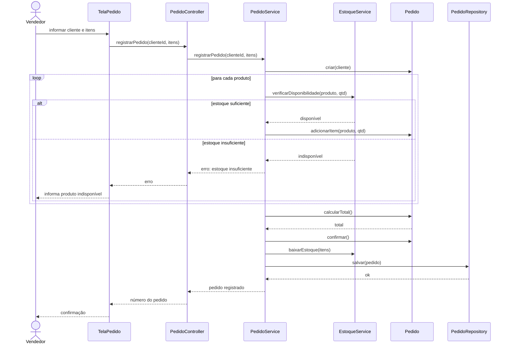

### Etapa 4 — Identificação das classes

| Classe | Camada | Responsabilidade | Atributos | Operações |
|---|---|---|---|---|
| Cliente | Domínio | Representar o cliente | id, nome, documento | — |
| Produto | Domínio | Representar o produto e seu estoque | id, nome, preco, quantidadeEmEstoque | `temEstoque(qtd)`, `baixarEstoque(qtd)` |
| Pedido | Domínio | Agregar itens e aplicar regras do pedido | id, data, status, cliente, itens, desconto | `adicionarItem()`, `calcularTotal()`, `confirmar()`, `cancelar()` |
| ItemPedido | Domínio | Representar produto e quantidade no pedido | produto, quantidade, precoUnitario | `calcularSubtotal()` |
| PedidoRepository | Domínio (interface) | Contrato de persistência do pedido | — | `salvar()`, `buscarPorId()`, `listarPorCliente()` |
| PoliticaDesconto | Domínio (serviço) | Calcular desconto autorizado | limite | `calcularDesconto(pedido)` |
| PedidoService | Aplicação | Coordenar registro, confirmação e cancelamento | — | `registrarPedido()`, `confirmarPedido()`, `cancelarPedido()`, `consultarHistorico()` |
| EstoqueService | Aplicação | Verificar e baixar estoque | — | `verificarDisponibilidade()`, `baixarEstoque()` |
| ClienteService / ProdutoService | Aplicação | Cadastros e consultas | — | `cadastrarCliente()`, `cadastrarProduto()`, `consultarProdutos()` |
| PedidoController, ClienteController, ProdutoController | Apresentação | Receber requisições HTTP e devolver respostas | — | `registrarPedido()`, etc. |
| PedidoRequestDTO, PedidoResponseDTO | Apresentação | Transportar dados de entrada e saída | itens, clienteId, total | — |
| PedidoRepositoryJpa, ClienteRepositoryJpa, ProdutoRepositoryJpa | Infraestrutura | Implementar a persistência | — | `salvar()`, `buscar...()` |

### Etapa 5 — Diagrama de Classes

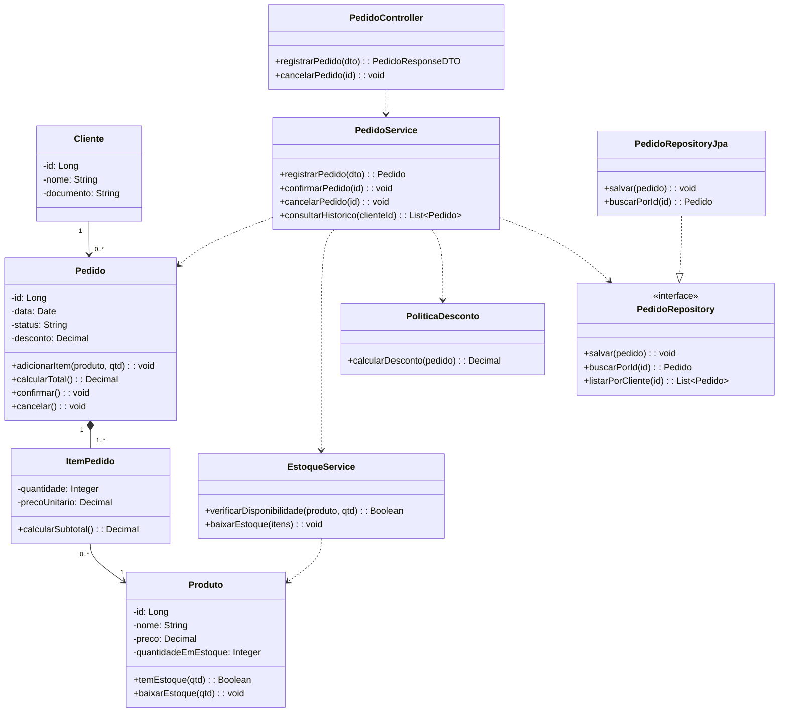

### Etapa 6 — Arquitetura

| Camada | Classes | Pode depender de | Deve evitar |
|---|---|---|---|
| Apresentação | Controllers, DTOs, telas | Aplicação | Acessar repositórios e conter regras de negócio |
| Aplicação | `PedidoService`, `EstoqueService`, `ClienteService`, `ProdutoService` | Domínio (incluindo interfaces de repositório) | Depender de HTTP/Controllers; conter regras que são do domínio |
| Domínio | `Pedido`, `ItemPedido`, `Produto`, `Cliente`, `PoliticaDesconto`, interfaces de repositório | Somente do próprio domínio | Depender de Controller, Service, JPA ou HTTP |
| Infraestrutura | `...RepositoryJpa`, e-mail, banco | Domínio (implementa suas interfaces) | Conter regras de negócio |

**Observação:** a divisão em camadas **não impõe** que todas dependam apenas da camada imediatamente abaixo, nem uma cadeia linear. Por exemplo, a infraestrutura depende do domínio (implementa as interfaces de repositório definidas nele), o que **inverte** a dependência tradicional; e a apresentação pode usar DTOs sem passar pelo domínio. O essencial é que o **domínio não dependa das demais camadas**.

### Etapa 7 — Estrutura de diretórios

```text
src/main/java/br/edu/sistema/
├── cliente/
│   ├── Cliente.java                    (entidade)
│   ├── ClienteController.java
│   ├── ClienteService.java
│   ├── ClienteRepository.java          (interface)
│   └── ClienteDTO.java
├── produto/
│   ├── Produto.java                    (entidade)
│   ├── ProdutoController.java
│   ├── ProdutoService.java
│   ├── EstoqueService.java
│   ├── ProdutoRepository.java          (interface)
│   └── ProdutoDTO.java
├── pedido/
│   ├── Pedido.java                     (entidade raiz)
│   ├── ItemPedido.java                 (composição de Pedido)
│   ├── PoliticaDesconto.java           (serviço de domínio)
│   ├── PedidoController.java
│   ├── PedidoService.java
│   ├── PedidoRepository.java           (interface)
│   ├── PedidoRequestDTO.java
│   └── PedidoResponseDTO.java
└── infra/
    ├── ClienteRepositoryJpa.java
    ├── ProdutoRepositoryJpa.java
    └── PedidoRepositoryJpa.java
```

### Etapa 8 — Documentação arquitetural

**1. Visão geral:** o sistema gerencia clientes, produtos e pedidos. O vendedor cadastra, consulta produtos, registra pedidos com itens, confirma ou cancela e consulta o histórico. É organizado em módulos (`cliente`, `produto`, `pedido`) com responsabilidades em camadas (apresentação, aplicação, domínio, infraestrutura).

**2. Decisões arquiteturais**

| Decisão | Justificativa |
|---|---|
| Organização por módulos de funcionalidade | Localiza o que pertence a cada assunto de negócio; facilita evolução e trabalho em equipe |
| Separação em camadas dentro dos módulos | Isola regras de negócio da tecnologia (HTTP, banco) |
| Regras no domínio (`Pedido`, `Produto`) | Evita entidades anêmicas e protege a consistência |
| Interfaces de repositório no domínio, implementação na infra | Domínio independente do banco; facilita testes |
| `ItemPedido` como composição de `Pedido` | Ciclo de vida dependente e propriedade exclusiva |
| Services de aplicação coordenam, não decidem | Evita classe Deus e regras duplicadas |

**3. Árvore de diretórios comentada:** ver Etapa 7 (`cliente/`, `produto/`, `pedido/` com as classes de cada módulo; `infra/` com as implementações de repositório).

**4. Responsabilidades das principais classes**
- `PedidoController`: recebe a requisição e devolve a resposta.
- `PedidoService`: coordena registro, confirmação e cancelamento.
- `Pedido`: mantém itens, calcula o total, confirma e cancela segundo as regras.
- `ItemPedido`: calcula subtotal.
- `EstoqueService`: verifica e baixa estoque.
- `PoliticaDesconto`: aplica descontos autorizados.
- `PedidoRepository` / `PedidoRepositoryJpa`: contrato e implementação de persistência.

**5. Diagramas:** Diagrama de Sequência (Etapa 3) e Diagrama de Classes (Etapa 5).

**6. Rastreabilidade RN–RF–UC–classes**

| RN | RF | UC | Classes / operações |
|---|---|---|---|
| RN01 — Pedido com cliente | RF04 | UC01 | `Pedido.criar(cliente)`, `PedidoService.registrarPedido()` |
| RN02 — Mínimo um item para confirmar | RF07 | UC01, UC05 | `Pedido.confirmar()` |
| RN03 — Estoque suficiente | RF05 | UC01 | `EstoqueService.verificarDisponibilidade()`, `Produto.temEstoque()` |
| RN04 — Total com descontos autorizados | RF06 | UC01 | `Pedido.calcularTotal()`, `PoliticaDesconto` |
| RN05 — Itens fixos após confirmação | RF05, RF07 | UC01, UC05 | `Pedido.adicionarItem()` (rejeita se confirmado) |
| RN06 — Cancelar só se não enviado | RF08 | UC06 | `Pedido.cancelar()`, `PedidoService.cancelarPedido()` |

**7. Regras de dependência entre módulos**
- A apresentação depende da aplicação; a aplicação depende do domínio; a infraestrutura implementa interfaces do domínio.
- O domínio não depende de Controller, Service nem de tecnologia (JPA/HTTP).
- `pedido` pode depender de `cliente` e `produto` (via serviços ou interfaces); `cliente` e `produto` **não** dependem de `pedido`.
- Controllers não acessam repositórios diretamente quando há regra de negócio envolvida.
- Evitar dependências circulares entre módulos.
