# Lista Master Class — Diagrama de Classes UML e Arquitetura

# Parte 1 — Fundamentos

## Ex. 1
a) **Casos de Uso:** quem usa o sistema e quais funcionalidades ele oferece.
b) **Sequência:** como os participantes colaboram ao longo do tempo em um cenário.
c) **Classes:** estrutura estática: classes, atributos, operações, relacionamentos e multiplicidades.
d) A sequência não mostra necessariamente atributos, tipos, visibilidade, multiplicidades nem relacionamentos permanentes (associação, composição, herança).
e) Casos de Uso definem *o quê*; a Sequência mostra *como* e revela operações e responsabilidades; o Diagrama de Classes consolida isso na estrutura a implementar.

## Ex. 2
| Classe | Atributos | Operações | Responsabilidade |
|---|---|---|---|
| Livro | id, título, autor, ISBN | adicionarExemplar() | Representar a obra |
| Exemplar | id, código, situação | estaDisponivel(), marcarEmprestado(), marcarDisponivel() | Cópia física emprestável |
| Aluno | id, nome, matrícula | — | Usuário do empréstimo |
| Emprestimo | id, dataEmprestimo, dataPrevistaDevolucao, dataDevolucao | registrarDevolucao(), estaAtrasado() | Registrar o empréstimo de um exemplar a um aluno |

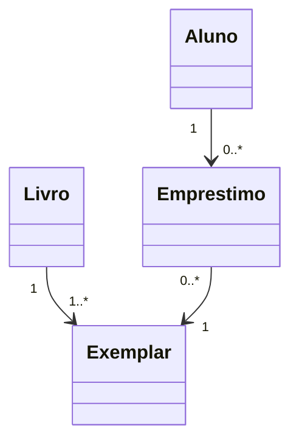

**Discussão:** não. Alguns substantivos são atributos (datas) ou estão fora do escopo (a própria biblioteca). Vira classe o que tem identidade, atributos e comportamento relevantes.

## Ex. 3
a) Nome, atributos e operações.
b) Atributos são os dados (estado); operações são os comportamentos.
c) `+` público; `-` privado.
d) O tipo do atributo ou o tipo de retorno da operação.
e) As operações expressam as responsabilidades da classe; só com atributos temos dados, sem comportamento.
f) A visibilidade implementa o encapsulamento: o estado fica privado e é acessado por operações públicas que protegem a consistência.

# Parte 2 — Relacionamentos

## Ex. 4
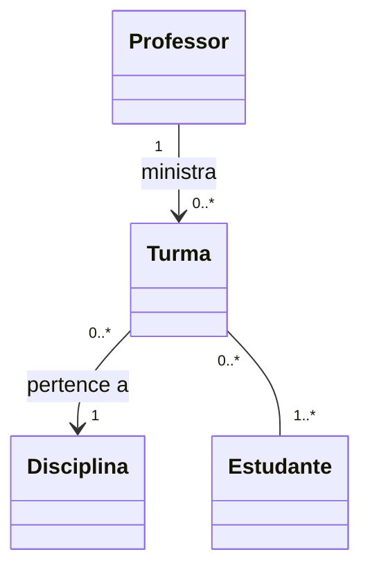
- `1` exatamente um; `0..1` zero ou um; `0..*` zero ou mais; `1..*` um ou mais.
- Definem quantos objetos se relacionam: atributo simples ou coleção, obrigatoriedade, chaves estrangeiras e tabela associativa (N:N).

## Ex. 5
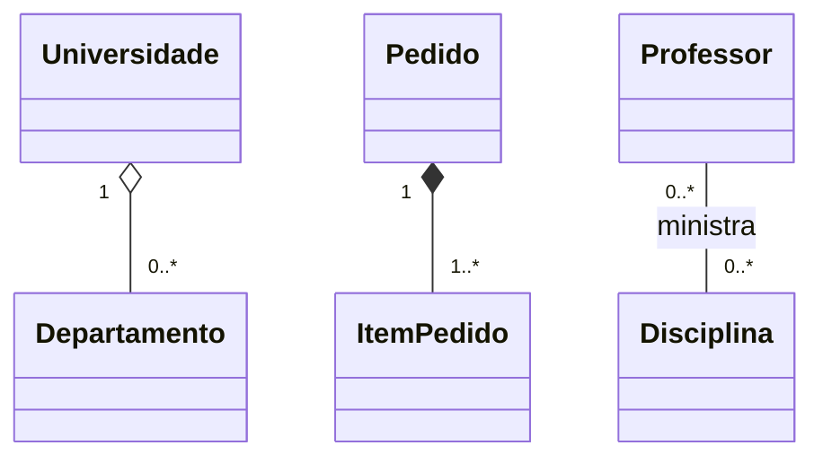
a) A: **agregação**; B: **composição**; C: **associação**.
b) Associação: relação entre objetos independentes. Agregação: todo-parte fraca, a parte existe sem o todo. Composição: todo-parte forte, a parte pertence só ao todo e depende dele.
c) As partes são destruídas junto com o objeto composto.
d) Composição exige propriedade exclusiva e ciclo de vida dependente; mera referência é só associação.
**Justificativa:** departamento tem identidade e sobrevive à universidade; o item não existe sem o pedido; professor e disciplina são independentes.

## Ex. 6
a) Superclasse `Pagamento`: id, valor, data, situação.
b) Compartilhados: `confirmar()`, `cancelar()`.
c) Específicos: Pix (chave, idTransação); Cartão (bandeira, parcelas, `autorizar()`); Boleto (código de barras, vencimento, `gerarBoleto()`).
d)
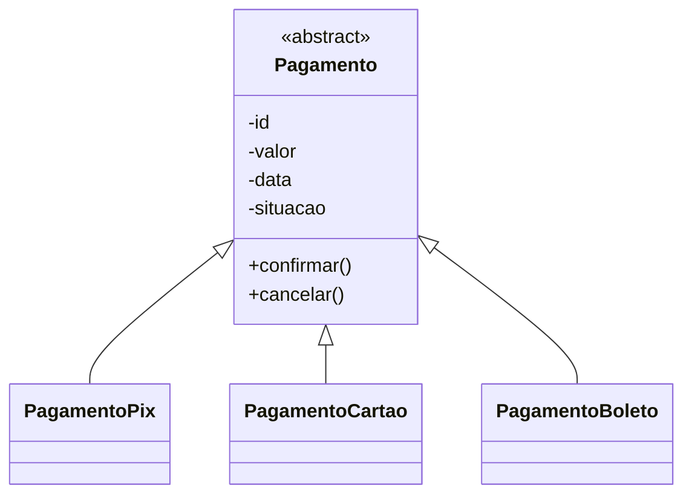
e) Herança: "é um". Composição: "tem um".
f) Prejudica com hierarquias profundas, alto acoplamento à superclasse, uso só para reaproveitar código e variações que não se encaixam; nesses casos usa-se composição.

# Parte 3 — Responsabilidades

## Ex. 7
a) `Pedido` apenas guarda dados (anêmica).
b) `PedidoService` concentra todas as regras.
c) Do domínio: `calcularTotal()`, `cancelar()`, `adicionarItem()`, `confirmar()`.
d) A service fica inchada, a entidade perde comportamento, as regras se espalham e fica difícil testar e evoluir.
e)
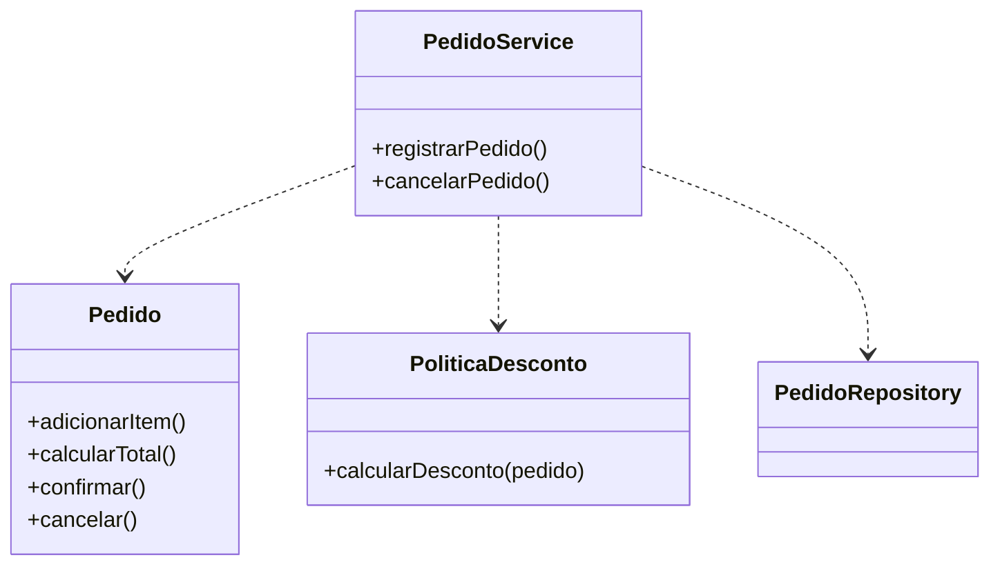
`Pedido`: regras do pedido; `PoliticaDesconto`: serviço de domínio; `PedidoService`: serviço de aplicação, que coordena e persiste.

## Ex. 8
a) Classe "Deus": mistura cadastro, frete, pagamento, relatório, autenticação e e-mail.
b) **Coesão:** quanto as responsabilidades de uma classe se relacionam. O desejável é alta.
c) **Acoplamento:** dependência entre classes. O desejável é baixo.
d) Qualquer mudança afeta a mesma classe, aumenta o risco de efeitos colaterais e obriga a testar tudo junto.
e) e f)
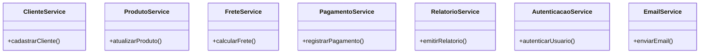

## Ex. 9
a) `TelaPedido`, `PedidoController`, `PedidoService`, `PedidoRepository`. O ator Cliente não vira classe.
b) Interface: `TelaPedido`. Aplicação: `PedidoController`/`PedidoService`. Domínio: `Pedido`, `ItemPedido`. Infraestrutura: `PedidoRepository`.
c) `informarDados()`, `registrarPedido()`, `salvar()`, `adicionarItem()`, `calcularTotal()`.
d) Parcialmente: parâmetros e retornos sugerem atributos, mas não definem nomes, tipos nem visibilidade.
e)
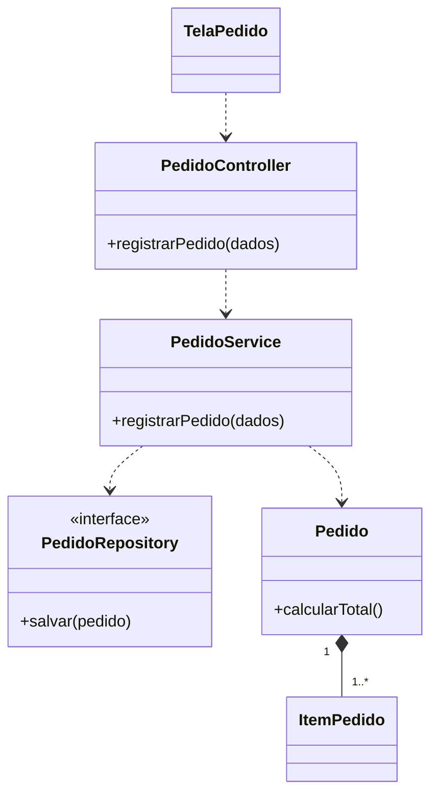
f) O diagrama de domínio representa conceitos do negócio; tela, controller e repositório pertencem a outras camadas, e o ator não é classe do sistema.

# Parte 4 — Arquitetura

## Ex. 10
| Nº | Camada |
|---|---|
| 1 Receber requisições HTTP | Apresentação |
| 2 Validar regras de negócio | Domínio |
| 3 Coordenar o caso de uso | Aplicação |
| 4 Consultar o banco | Infraestrutura |
| 5 Representar uma entidade | Domínio |
| 6 Converter dados em objetos | Apresentação (DTOs) |
| 7 Persistir alterações | Infraestrutura |
| 8 Retornar resposta HTTP | Apresentação |

a/b)
| Camada | Finalidade | Classes |
|---|---|---|
| Apresentação | Interagir com o usuário/cliente | Controllers, DTOs |
| Aplicação | Coordenar casos de uso | Services |
| Domínio | Regras e conceitos do negócio | Entidades, serviços de domínio, interfaces de repositório |
| Infraestrutura | Recursos técnicos (banco, e-mail) | Implementações de repositório |

c) Camada lógica é divisão por responsabilidade e dependência; diretório físico é a organização dos arquivos.
d) Não. A arquitetura exige separar responsabilidades, não ter quatro pastas.
e) Isola mudanças, facilita testes, localização do código e trabalho em equipe.

## Ex. 11
a) Controller: recebe e devolve HTTP. Service: coordena o caso de uso. Produto: conceito e regras do domínio. Repository: acesso aos dados.
b) `ProdutoController`. c) `ProdutoService`. d) `Produto`. e) `ProdutoRepository`.
f) O domínio deve ser independente da tecnologia de entrega, para ser testável e reutilizável.
g)
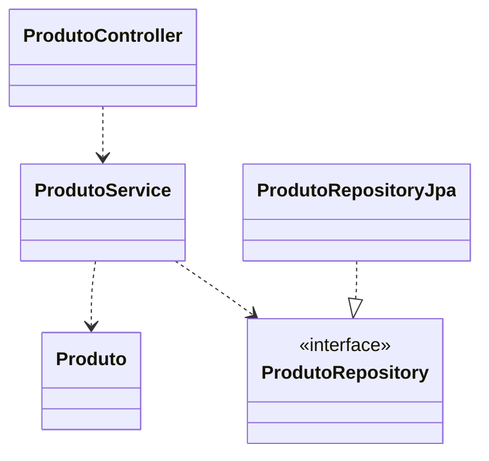
O contrato `ProdutoRepository` fica no domínio; `ProdutoRepositoryJpa` fica na infraestrutura.

## Ex. 12
a) O controller mistura apresentação, regras (desconto, estoque, preço) e acesso a dados: acoplamento, regras presas ao HTTP, difícil testar e reutilizar.
b) Não é sempre incorreto: em consultas simples, sem regra, pode ser aceito. Aqui há regras, então é inadequado.
c) `ProdutoController → ProdutoService → Produto / ProdutoRepository`.
d) Domínio: validar estoque, regras de preço e desconto.
e) Aplicação: coordenar buscar, aplicar regras, persistir e responder.
f)
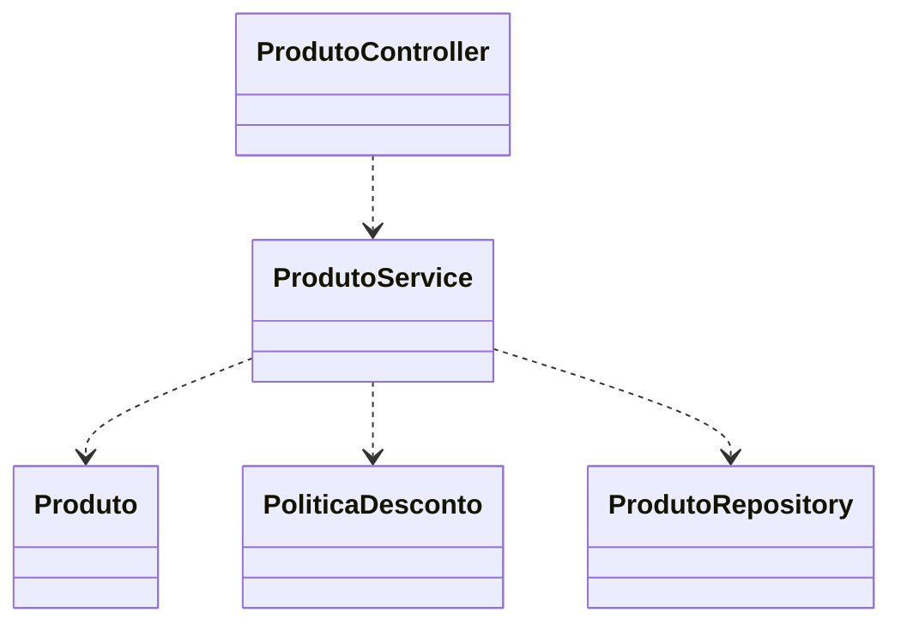

# Parte 5 — Diretórios e documentação

## Ex. 13
a) Pasta única difícil de navegar, mistura de responsabilidades, arquitetura invisível e conflitos de equipe.
b) **Por camadas:** `controller/`, `service/`, `repository/`, `model/`.
c) **Por funcionalidades:** `cliente/`, `produto/`, `pedido/`, cada um com suas classes.
d) Camadas: arquitetura visível, mas uma funcionalidade fica espalhada. Funcionalidades: tudo junto, mais coeso, mas as camadas ficam menos visíveis.
e) Por funcionalidades (pasta `pedido/`).
f) Por funcionalidades, com separação de responsabilidades dentro de cada módulo: facilita mudanças localizadas e escala melhor.

## Ex. 14
a) A: tipo técnico. B: assunto de negócio.
b) A: camadas explícitas, mas funcionalidades dispersas. B: coesão por módulo e mudanças localizadas, mas camadas menos visíveis e risco de dependência cruzada.
c) A mostra a divisão técnica; B mostra o que o sistema faz.
d) Não. Boa arquitetura vem das responsabilidades e das regras de dependência.
e) Módulo por funcionalidade com subdivisão interna:
```text
pedido/
├── apresentacao/  PedidoController, PedidoDTO
├── aplicacao/     PedidoService
├── dominio/       Pedido, PedidoRepository (interface)
└── infra/         PedidoRepositoryJpa
```

## Ex. 15
| Campo | Descrição |
|---|---|
| Classe | `PedidoService` |
| Responsabilidade | Coordenar o caso de uso Registrar Pedido (acionar o domínio, persistir e devolver o resultado) |
| Operações | `registrarPedido(pedido: Pedido): void` — valida via domínio, persiste; em violação de regra lança exceção e nada é gravado |
| Dependências | `PedidoRepository`, `Pedido`, `ItemPedido`, `EstoqueService` |
| RN relacionadas | RN01, RN02, RN03 |
| RF relacionadas | RF01 |
| UC relacionados | UC01 — Registrar Pedido |

**Discussão:** o Caso de Uso descreve o comportamento do ponto de vista do ator (*o que*); a documentação da classe descreve responsabilidade, operações e dependências no projeto (*quem* e *como*).

# Parte 6 — Integração

## Ex. 16
```text
RN01 → RF01 → UC01 → Sequência (alt: disponível / indisponível)
→ PedidoController.registrarPedido(), PedidoService.registrarPedido(),
  EstoqueService.verificarDisponibilidade(), Pedido.confirmar(), PedidoRepository.salvar()
→ módulos pedido/ e produto/
```
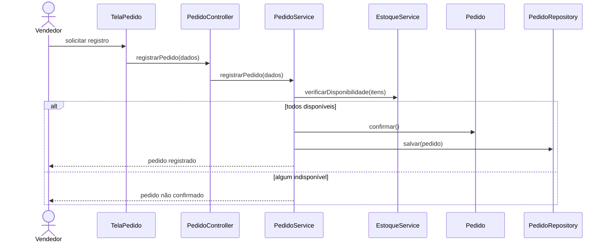
a) `TelaPedido`, `PedidoController`, `PedidoService`, `EstoqueService`, `Pedido`, `ItemPedido`, `Produto`, `PedidoRepository`.
b) `EstoqueService` (via `Produto.temEstoque()`).
c) `Pedido.confirmar()`, acionado pelo `PedidoService` só se tudo estiver disponível.
d) É a condição do `alt`.
e) No campo "RN relacionadas" da documentação das classes, na matriz RN–RF–UC–classe e nos comentários dos métodos que aplicam a regra.

## Ex. 17
a/b)
| Classe | Atributos | Operações |
|---|---|---|
| Produto | id, código, nome, quantidadeEmEstoque | adicionar(qtd), retirar(qtd), temEstoque(qtd) |
| Movimentacao | id, tipo, quantidade, dataHora | — |
| Usuario | id, nome, perfil | podeRegistrarMovimentacao() |

c/d)
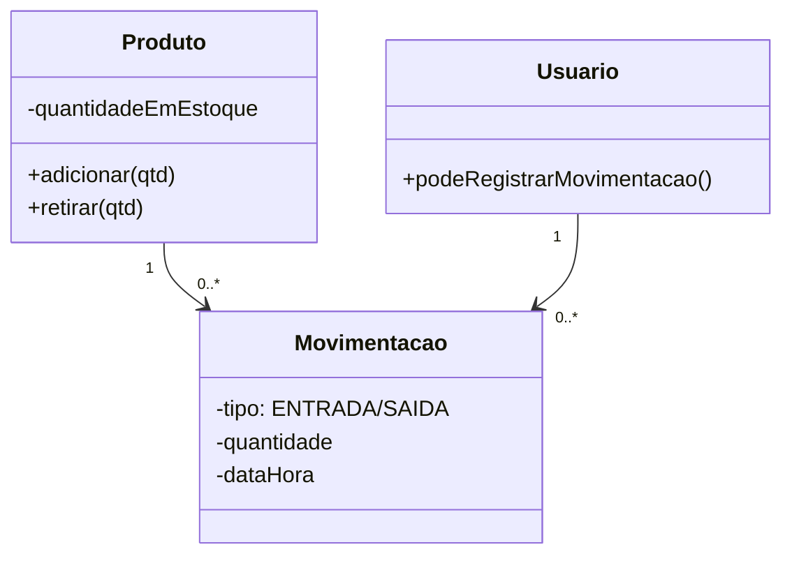
e) Aplicação: `ProdutoController`, `MovimentacaoController`, `EstoqueService` (cadastrar, entrada, saída, consulta), `RelatorioService`.
f) Infraestrutura: repositórios JPA de produto e movimentação, autenticação/autorização, geração do relatório.
g)
```text
estoque/
├── produto/        Produto, ProdutoController, ProdutoRepository
├── movimentacao/   Movimentacao, MovimentacaoController, MovimentacaoRepository
├── aplicacao/      EstoqueService, RelatorioService
├── usuario/        Usuario
└── infra/          repositórios JPA, segurança
```
h)
| RN | Onde |
|---|---|
| RN01 | Domínio: `Produto.retirar()` rejeita saída maior que o saldo |
| RN02 / RN03 | Aplicação: `EstoqueService` cria a `Movimentacao` junto com cada entrada/saída |
| RN04 | Aplicação/segurança: verifica `Usuario.podeRegistrarMovimentacao()` antes de registrar |

# Parte 7 — Projeto completo

## Ex. 18 — Gerenciamento de Pedidos

### Etapa 1 — Análise
**RF:** RF01 cadastrar clientes · RF02 cadastrar produtos · RF03 consultar produtos · RF04 registrar pedidos · RF05 adicionar produtos ao pedido · RF06 calcular total · RF07 confirmar pedidos · RF08 cancelar pedidos · RF09 consultar histórico.
**RNF:** RNF01 consulta de produtos em até 2 s (desempenho) · RNF02 acesso apenas de usuários autenticados (segurança) · RNF03 estoque e pedido gravados de forma consistente (integridade).
**Atores:** Vendedor; Gerente (autoriza descontos).
**Casos de uso:** UC01 Registrar Pedido · UC02 Cadastrar Cliente · UC03 Cadastrar Produto · UC04 Consultar Produtos · UC05 Confirmar Pedido · UC06 Cancelar Pedido · UC07 Consultar Histórico.

### Etapa 2 — UC01 Registrar Pedido
- **Objetivo:** registrar um pedido de um cliente com um ou mais produtos.
- **Ator:** Vendedor (secundário: Gerente).
- **Pré:** vendedor autenticado; cliente e produtos cadastrados.
- **Pós:** pedido registrado com itens e total; estoque atualizado.

**Fluxo principal**
1. Vendedor solicita registrar um pedido e informa o cliente (RN01).
2. Para cada produto, o vendedor informa produto e quantidade.
3. Sistema verifica o estoque (RN03) e adiciona o item.
4. Sistema calcula o total com descontos autorizados (RN04).
5. Vendedor confirma.
6. Sistema verifica que há ao menos um item (RN02).
7. Sistema registra o pedido, atualiza o estoque e informa o número do pedido.

**Alternativo:** A1 desconto acima do limite: sistema pede autorização do gerente e recalcula (passo 4) · A2 vendedor remove item · A3 vendedor desiste.
**Exceções:** E1 cliente não informado (RN01) · E2 estoque insuficiente (RN03) · E3 pedido sem itens (RN02) · E4 desconto não autorizado (RN04) · E5 falha ao registrar.
**Regras:** RN01–RN05. **Requisitos:** RF04, RF05, RF06, RF07, RNF03.

### Etapa 3 — Diagrama de Sequência
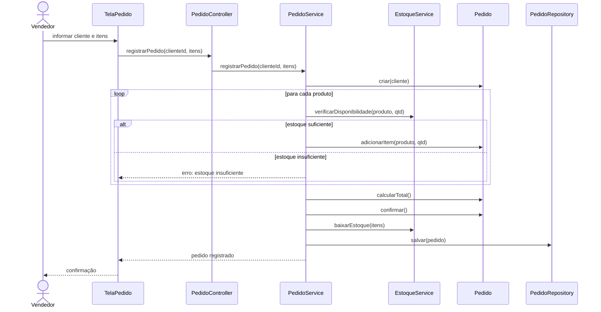

### Etapa 4 — Classes
| Classe | Responsabilidade | Atributos | Operações |
|---|---|---|---|
| Cliente (domínio) | Representar o cliente | id, nome, documento | — |
| Produto (domínio) | Produto e estoque | id, nome, preço, quantidadeEmEstoque | temEstoque(), baixarEstoque() |
| Pedido (domínio) | Raiz do pedido e suas regras | id, data, status, desconto | adicionarItem(), calcularTotal(), confirmar(), cancelar() |
| ItemPedido (domínio) | Produto e quantidade no pedido | quantidade, precoUnitario | calcularSubtotal() |
| PoliticaDesconto (domínio) | Desconto autorizado | limite | calcularDesconto() |
| PedidoRepository (interface do domínio) | Contrato de persistência | — | salvar(), buscarPorId(), listarPorCliente() |
| PedidoService (aplicação) | Coordenar registro, confirmação, cancelamento | — | registrarPedido(), confirmarPedido(), cancelarPedido(), consultarHistorico() |
| EstoqueService (aplicação) | Verificar e baixar estoque | — | verificarDisponibilidade(), baixarEstoque() |
| Controllers e DTOs (apresentação) | Receber requisições e devolver respostas | — | registrarPedido(), cancelarPedido() |
| *RepositoryJpa (infraestrutura) | Implementar persistência | — | salvar(), buscar...() |

### Etapa 5 — Diagrama de Classes
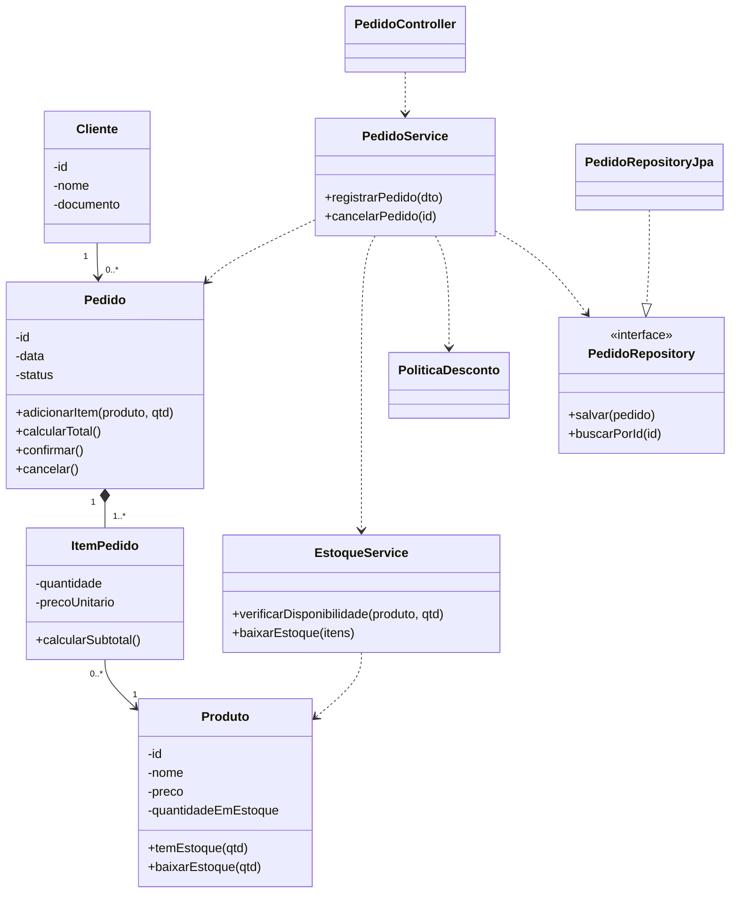

### Etapa 6 — Arquitetura
| Camada | Classes | Pode depender de | Evitar |
|---|---|---|---|
| Apresentação | Controllers, DTOs | Aplicação | Repositórios e regras de negócio |
| Aplicação | Services | Domínio | HTTP/Controllers; regras que são do domínio |
| Domínio | Entidades, `PoliticaDesconto`, interfaces de repositório | Só o próprio domínio | Controller, Service, JPA, HTTP |
| Infraestrutura | `*RepositoryJpa`, e-mail, banco | Domínio (implementa suas interfaces) | Regras de negócio |

As camadas **não** implicam dependência unidirecional entre todas: a infraestrutura depende do domínio (implementa as interfaces de repositório dele), invertendo a dependência tradicional. O essencial é que o domínio não dependa das demais camadas.

### Etapa 7 — Diretórios
```text
src/main/java/br/edu/sistema/
├── cliente/   Cliente, ClienteController, ClienteService, ClienteRepository, ClienteDTO
├── produto/   Produto, ProdutoController, ProdutoService, EstoqueService, ProdutoRepository, ProdutoDTO
├── pedido/    Pedido, ItemPedido, PoliticaDesconto, PedidoController, PedidoService,
│              PedidoRepository, PedidoRequestDTO, PedidoResponseDTO
└── infra/     ClienteRepositoryJpa, ProdutoRepositoryJpa, PedidoRepositoryJpa
```

### Etapa 8 — Documentação arquitetural
**1. Visão geral:** sistema para gerenciar clientes, produtos e pedidos, organizado em módulos (`cliente`, `produto`, `pedido`) com camadas de apresentação, aplicação, domínio e infraestrutura.

**2. Decisões**
| Decisão | Justificativa |
|---|---|
| Módulos por funcionalidade | Localiza o negócio e facilita a evolução |
| Camadas dentro dos módulos | Isola regras da tecnologia |
| Regras no domínio | Evita entidades anêmicas e protege a consistência |
| Interface de repositório no domínio, implementação na infra | Domínio independente do banco |
| `ItemPedido` composto em `Pedido` | Ciclo de vida dependente |
| Services só coordenam | Evita classe Deus |

**3. Árvore de diretórios:** Etapa 7.

**4. Responsabilidades:** `PedidoController` recebe e responde; `PedidoService` coordena; `Pedido` aplica as regras do pedido; `ItemPedido` calcula subtotal; `EstoqueService` verifica e baixa estoque; `PoliticaDesconto` calcula desconto; `PedidoRepository`/`PedidoRepositoryJpa` fazem a persistência.

**5. Diagramas:** Etapas 3 e 5.

**6. Rastreabilidade**
| RN | RF | UC | Classes |
|---|---|---|---|
| RN01 | RF04 | UC01 | `Pedido.criar(cliente)`, `PedidoService.registrarPedido()` |
| RN02 | RF07 | UC01, UC05 | `Pedido.confirmar()` |
| RN03 | RF05 | UC01 | `EstoqueService.verificarDisponibilidade()`, `Produto.temEstoque()` |
| RN04 | RF06 | UC01 | `Pedido.calcularTotal()`, `PoliticaDesconto` |
| RN05 | RF05, RF07 | UC01, UC05 | `Pedido.adicionarItem()` (rejeita se confirmado) |
| RN06 | RF08 | UC06 | `Pedido.cancelar()`, `PedidoService.cancelarPedido()` |

**7. Regras de dependência**
- Apresentação → Aplicação → Domínio; a infraestrutura implementa as interfaces do domínio.
- O domínio não depende de Controller, Service nem de tecnologia.
- `pedido` pode depender de `cliente` e `produto`; o inverso não.
- Controllers não acessam repositórios quando há regra de negócio.
- Sem dependências circulares entre módulos.
